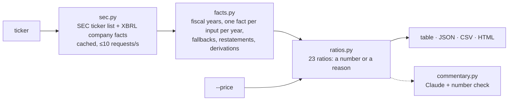

# edgar-ratios

**Financial ratios straight from SEC filings: type a ticker, get 23 ratios over five years, every number
traced to the 10-K it came from.**

```bash
edgar-ratios AAPL
```

It reads the numbers companies file with the SEC (the US markets regulator) in machine-readable form,
works out margins, returns, liquidity, leverage and efficiency for each fiscal year, and tells you
exactly where each input came from. When a number can't be found, the ratio says **n/a and why**. It
is never guessed, estimated or filled with zero.

[](https://github.com/owen-alderson/edgar-ratios/actions/workflows/ci.yml)
[](https://pypi.org/project/edgar-ratios/)


## Why

Most free ratio sites don't show their working. You can't tell whether "debt" includes leases, which
year a figure belongs to, or whether a number was restated. edgar-ratios is built the other way round:

- **Every input is traceable.** `--sources` lists, for each figure, the XBRL concept (the official tag
  the company used, e.g. `RevenueFromContractWithCustomerExcludingAssessedTax`), the filing it came
  from, when it was filed, and a link to it.
- **Missing means missing.** Apple stopped reporting interest expense as its own line after fiscal
  2023, so its interest coverage for 2024 and 2025 shows as n/a with that reason, not as a made-up
  number.
- **Restatements are visible.** Companies often revise last year's numbers in this year's report.
  The most recently filed value is used and the change is noted, including per-share figures that
  changed because of a stock split ("consistent with a 10-for-1 stock split").
- **No invented prices.** SEC filings don't contain share prices, so valuation ratios (P/E,
  EV/EBITDA...) only appear when you pass one with `--price`. They are labelled as using your price.

## Quickstart

```bash
pipx install edgar-ratios
edgar-ratios AAPL
```

The first run asks for your name and email. The SEC asks every tool that reads its data to identify
itself ([its rules](https://www.sec.gov/os/accessing-edgar-data)); it's only sent to sec.gov and is
saved in `~/.edgar-ratios/config.json`. You can also set it up front:

```bash
edgar-ratios --set-user-agent "Jane Doe jane@example.com"
```

More:

```bash
edgar-ratios AAPL --years 8                  # longer history
edgar-ratios AAPL --price 227.50             # add valuation ratios at a price you supply
edgar-ratios AAPL MSFT NVDA                  # compare each company's latest fiscal year
edgar-ratios AAPL MSFT --price AAPL=227.50 --price MSFT=510
edgar-ratios AAPL --sources                  # where every input came from
edgar-ratios AAPL --html aapl.html           # self-contained report, every figure linked to its filing
edgar-ratios AAPL --format json              # everything, with provenance, for scripts
edgar-ratios AAPL MSFT --format csv          # one row per ratio per year
edgar-ratios AAPL --commentary               # a short read-out written by Claude
```

`--commentary` needs an Anthropic API key in `ANTHROPIC_API_KEY` or in `~/.edgar-ratios/.env`.
Claude (`claude-opus-5-5`) only sees the computed ratios, is told to use them exactly as written, and
every number in its reply is checked against the table: anything that doesn't match is listed under
the commentary so you can check it.

## The ratios

All balance-sheet figures are year-end values (not averages). "Debt" is long-term debt including the
part due within a year, plus short-term borrowings or commercial paper; leases are not included.

| Category | Ratio | What it tells you |
|---|---|---|
| **Valuation** (needs `--price`) | P/E | Share price ÷ diluted earnings per share: what you pay for $1 of yearly profit |
| | EV/EBITDA | Enterprise value (market cap + debt − cash, i.e. the price of the whole business) ÷ EBITDA |
| | EV/Revenue | Enterprise value ÷ revenue |
| | P/B | Market cap ÷ book value (shareholders' equity on the balance sheet) |
| | P/S | Market cap ÷ revenue |
| **Profitability** | Gross margin | What's left of each $1 of sales after the direct cost of what was sold |
| | EBITDA margin | EBITDA ÷ revenue. EBITDA = operating income + depreciation & amortization, a rough measure of cash profit from operations |
| | Operating margin | Profit from the core business ÷ revenue |
| | Net margin | The bottom line ÷ revenue |
| | ROE | Net income ÷ shareholders' equity |
| | ROA | Net income ÷ total assets |
| | ROIC | Net income ÷ (equity + debt), a simple version of return on invested capital |
| **Liquidity** | Current ratio | Current assets ÷ current liabilities: can it pay what's due within a year? |
| | Quick ratio | The same without inventory |
| | Cash ratio | Cash ÷ current liabilities, the strictest version |
| **Leverage** | Debt/Equity | Debt ÷ equity |
| | Net debt/EBITDA | (Debt − cash) ÷ EBITDA: years of operating profit to pay off net debt. Negative = more cash than debt |
| | Debt/Assets | Debt ÷ total assets |
| | Interest coverage | Operating income ÷ interest expense. Under 1.5x is a warning sign |
| **Efficiency** | Asset turnover | Revenue ÷ total assets |
| | Inventory turnover | Cost of revenue ÷ inventory: how many times stock is sold through a year |
| | Days inventory | Days of stock on hand |
| | Days sales outstanding | Days customers take to pay |

A ratio is shown as n/a, with the reason, when an input isn't reported, or when its denominator is
zero or negative (a P/E on negative earnings or an ROE on negative equity isn't meaningful).

## How it works



The data is the SEC's free [XBRL company facts API](https://www.sec.gov/search-filings/edgar-application-programming-interfaces):
every number each company has tagged in its filings. [`facts.py`](edgar_ratios/facts.py) holds every rule:

- **Fiscal years** come from the company's 10-K annual reports, labelled the way the company labels
  them (NVIDIA's "fiscal 2026" ended on 25 January 2026).
- **One number per input per year.** A flow figure such as revenue must cover one full year
  (350-380 days, so 52/53-week years count) ending on the fiscal year end; a balance-sheet figure
  must be dated on it. Only 10-K and 10-K/A filings count, so quarterly numbers never leak in.
- **Latest filing wins.** Each figure is repeated in later reports as a comparison. The most recently
  filed value is used, and any difference from the first-filed one is noted.
- **Fallbacks are explicit.** Each input has an ordered list of concepts, because companies change
  tags over time (Apple's revenue moved from `SalesRevenueNet` to
  `RevenueFromContractWithCustomerExcludingAssessedTax`). The concept used is recorded per year.
- **Derived figures say so.** Gross profit computed as revenue minus cost of revenue, debt built from
  its parts, D&A built from depreciation plus amortization: each is labelled.
- **P/E is protected against splits.** If the share count today is far from the one implied by the
  10-K's EPS (a stock split since the report), P/E is n/a rather than off by the split factor.

Downloads are cached in `~/.edgar-ratios/cache` for a day (`--refresh` to refetch).

**Limits:** US companies that file 10-Ks with US GAAP tags. Foreign companies filing 20-F or 40-F
aren't supported. Banks and insurers don't report current assets, gross profit or operating income,
so those ratios show as n/a for them.

## Development

```bash
git clone https://github.com/owen-alderson/edgar-ratios && cd edgar-ratios
python -m venv .venv && . .venv/bin/activate
pip install -e '.[dev]'
pytest            # 200 tests, no network
```

The tests run on real EDGAR data for Apple, Microsoft, NVIDIA, JPMorgan and Alphabet, trimmed to the
concepts the tool reads ([`tests/fixtures/trim.py`](tests/fixtures/trim.py) rebuilds them). The Claude
tests run the real SDK against a mocked HTTP transport, so the exact request is checked. Releases:
push a `vX.Y.Z` tag and GitHub Actions publishes to PyPI.

The original Streamlit app, where you typed the figures in by hand, is kept at tag
[`v1-streamlit`](https://github.com/owen-alderson/edgar-ratios/tree/v1-streamlit).

## Disclaimer

Not investment advice. The ratios are computed from companies' own SEC filings, and `--commentary` is written by Claude, which can be wrong; check anything you rely on against the filing itself. Not affiliated with or endorsed by the SEC or the companies shown.

## License

MIT
